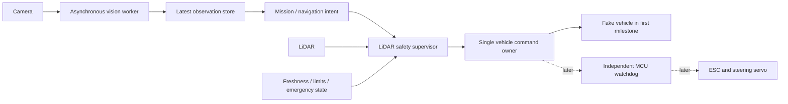

# Architecture — draft for review

## Intent and authorization
Plan a modular, hackathon-sized Jetson RC robot. Current authorization is **documentation only**. Do not implement, launch coding agents, initialize repositories, commit, merge, deploy or actuate hardware from these instructions until the user explicitly resumes coding.

## Architecture choices
1. Four separate repositories: administrative independence but extra dependency/version/release overhead.
2. One repository with four isolated branches/worktrees: recommended; single shared contract and test gate.
3. Full ROS/SLAM/AI stack immediately: higher build risk while hardware/software compatibility is unknown.
Proposed first milestone: portable Python standard-library core and fake outputs; later ROS adapters. These are recommendations, not accepted implementation decisions.

## Invariants
- AI identifies targets; it does not issue motor signals.
- Safety is the final gate on all manual/autonomous motion.
- Inference never runs synchronously inside the control loop and never holds a control-path lock.
- Keep one inference in flight and at most one pending latest frame. Drop superseded pending frames, not control deadlines.
- Preserve image capture timestamps through inference; reject stale, future and out-of-order observations.
- Control continues using still-valid state between vision updates. Required state expiry, sensor faults and obstacles may require a stop; uninterrupted motion is not a safety guarantee.
- Use one monotonic clock domain in the portable core. ROS/device clock adapters must handle resets and offsets.
- Reverse remains disabled until rear sensing and recovery policies are verified.

## Responsibility boundaries
| Lane | Module | Owns | Does not own |
|---|---|---|---|
| Safety | safety.py | Sensor health, conservative forward envelope, motion gating | Model inference, PWM, map planner |
| Control | control.py | Fake output, limits, software watchdog; later MCU interface | Target selection, obstacle interpretation |
| Perception | perception.py | Latest-only async handoff, target freshness | Steering, navigation, safety |
| Mission | mission.py | Bounded intent/state from valid target | Hardware, obstacle bypass, inferred depth |
| Integrator | contracts, orchestration, tests | Common API, cross-lane wiring, review/merge | Silent rewrites of lane ownership |

## First milestone versus actual robot
Portable core: synthetic scan and target records; a fail-closed supervisor; fake actuation; asynchronous injectable inference; pure mission step. It is not a physical dynamics simulator, model benchmark, SLAM system or navigation-to-object implementation.

Actual robot: compatible ROS 2 sensor adapters, odometry, transforms, Ackermann constraints, independent MCU watchdog, measured braking/swept footprint, mapping/localization, reachable goals and camera/depth association. These are later gated tasks.

## Future navigation and target flow
First prove a known map goal. Then use AprilTags for station IDs. For semantic targets, an image box/bearing must be associated with calibrated depth or a known map landmark, uncertainty estimated, and a collision-free stand-off goal generated. A 2D LiDAR scan may miss the camera object's height entirely. Do not assume every box has matching laser depth.

## Safety limitations
2D LiDAR can miss low/high obstacles, drop-offs, glass and blind zones. A fixed front-circle threshold does not model braking, moving obstacles, turning swept volume, wheel slip or system latency. Software timeout logic cannot stop a crashed host process; hardware needs an independently enforced timeout and physical cutoff. Never use people as collision-test obstacles.

## Build-time risk policy
Do not spend the hackathon porting custom quantization. Benchmark an already-supported backend on the actual Jetson before committing the demo to it. An Apple Silicon MLX conversion is not a Jetson deployment. Keep all accuracy, memory and latency claims explicitly unmeasured until observed.

## Integration policy
Freeze shared contracts first. Independently test/review complete slices; merge into integration, rerun all tests after every merge, then promote a reviewed green milestone to main. No arbitrary percentage-complete merges or remote pushes without an approved destination.
